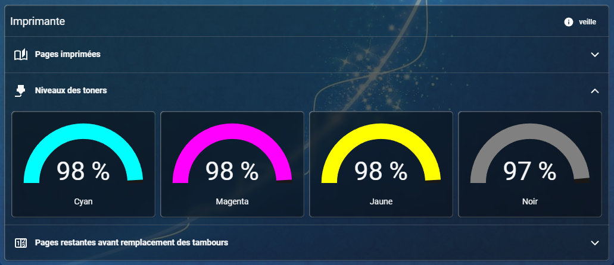

# Flex Accordion Card

English · [Français](docs/README.fr.md) · [Español](docs/README.es.md) · [Deutsch](docs/README.de.md)

An accordion container for Home Assistant dashboards, with nested Lovelace cards, native badges and a contextual visual editor.



[Watch the demonstration — MP4, 11 s](docs/media/accordion-demo.mp4) · [More screenshots](docs/SHOWCASE.md)

## Features

- Unified card or separate section cards, with an optional global background.
- Optional global header with title, icon, badges and adjustable title size.
- Clickable section headers with icons and badges placed before the chevron.
- Native and custom Lovelace cards with individual widths and heights in the native Sections grid.
- Exclusive mode, always-open sections, height and fade animations, and reduced-motion support.
- Contextual editor with sticky navigation, drag-and-drop, reorder buttons, and move/copy controls.
- Native Entity and Shortcut badges, with live preview, configurable actions and individual appearance options.
- Home Assistant visibility conditions for sections, badges and nested cards.
- Interface in English, French, Spanish and German, following your Home Assistant profile language.

## Installation

### HACS (custom repository)

The card is available as a custom repository while default-catalog inclusion is pending. In HACS, open the three-dot menu → Custom repositories, add `https://github.com/PedroDelCargo/flex-accordion-card` with category **Dashboard**, then download Flex Accordion Card. When resources are managed in the Home Assistant UI, HACS normally registers the module automatically. Keep only the HACS resource (`/hacsfiles/flex-accordion-card/flex-accordion-card.js` with its version suffix) and remove any old manual/test resource for this card. Resources managed in YAML must be declared manually. Reload the browser completely.

### Manual installation

1. Download **flex-accordion-card.js** from the [latest GitHub release](https://github.com/PedroDelCargo/flex-accordion-card/releases/latest).
2. Copy it to `<config>/www/flex-accordion-card.js` on your Home Assistant installation. Create `www` if necessary; restart Home Assistant once after creating it.
3. In your dashboard resources, add `/local/flex-accordion-card.js?v=1.0.0` with type **JavaScript module**. Enable advanced mode in your profile if the resources menu is hidden.
4. Reload the browser completely, then add **Flex Accordion Card** to a dashboard. Alternatively, choose the native **Manual** card and paste the YAML example below.

For dashboards with resources managed in YAML, add the resource to your existing configuration:

```yaml
lovelace:
  resources:
    - url: /local/flex-accordion-card.js?v=1.0.0
      type: module
```

To update, replace the JavaScript file, change the `?v=` suffix and reload the browser. Register the resource only once. To uninstall, remove the cards, the resource and the JavaScript file.

## Using the visual editor

Start with **General settings** to select the layout, background, exclusive mode and animations. Configure the optional global header, then add your sections.

Open a section to manage its header, badges, cards and visibility. The pencil opens an item on its own page; the navigation at the top returns to its parent. Use the handles or arrow buttons to reorder items. The move and copy buttons let you choose a destination section; copying also offers **Current section**.

When adding a badge, choose **Entity** or **Shortcut**. Entity badges require an entity; shortcut badges use text, an icon and actions without an entity. Configure **Content**, **Interactions** and **Visibility**, check the preview, then select **Add badge**. Under Content, **Hide border** and **Transparent background** can be enabled independently for each badge, including global-header badges.

Use **Code editor** / **Visual editor** to switch modes. To add a card from a configuration, choose **Manual**, enter its YAML and select **Add card**. If the native YAML editor is unavailable, an explicitly labelled JSON editor is offered.

Enable **Always open** for a section that should remain expanded without a header, badges or chevron. Place it first or last for a fixed header or footer within the card. Add a native Heading card inside if needed. Visibility conditions still apply.

## YAML configuration

```yaml
type: custom:flex-accordion-card
layout: unified
exclusive: true
header:
  title: Home
  icon: mdi:home
sections:
  - id: living-room
    title: Living room
    icon: mdi:sofa
    default_open: true
    layout: sections
    cards:
      - type: button
        entity: light.living_room
      - type: markdown
        content: Welcome home
    badges:
      - type: entity
        entity: sensor.living_room_temperature
        show_name: true
        show_state: true
        hide_border: true
      - type: shortcut
        text: Home
        icon: mdi:home
        transparent_background: true
        tap_action:
          action: navigate
          navigation_path: /lovelace/home
  - id: footer
    layout: sections
    always_open: true
    cards:
      - type: markdown
        content: Home sweet home
```

Replace the entity IDs and navigation path with your own. More examples: [starter](examples/starter.yaml), [always-open sections](examples/always-open.yaml).

## Configuration reference

### Global options

| Option | Default | Description |
| --- | --- | --- |
| `type` | required | Required; `custom:flex-accordion-card` |
| `layout` | `unified` | `unified` or `separate` |
| `background` | `false` | Background and spacing around all sections |
| `exclusive` | `false` | At most one accordion section open; all may be closed |
| `animation` | `true` | Height and fade animations |
| `animation_duration` | `750` | Duration in milliseconds, integer from 0 to 2000 |
| `header` | none | Optional global header |
| `sections` | required | Section list; may be empty |

### Global header: `header`

| Option | Default | Description |
| --- | --- | --- |
| `enabled` | `true` | Show the header; disabling it retains its settings |
| `title` | empty text | Header title |
| `icon` | none | Home Assistant icon |
| `text_size` | `16` | Positive number of pixels; blank field uses 16 px |
| `badges` | `[]` | Native view badge configurations |

### Each entry in `sections`

| Option | Default | Description |
| --- | --- | --- |
| `id` | `section-N` | Unique identifier; use stable IDs when writing YAML |
| `title` | `Section N` | Section title |
| `icon` | none | Home Assistant icon |
| `always_open` | `false` | Always expanded, without header or badges; independent of exclusive mode |
| `default_open` | `false` | Initial open state; ignored for always-open sections |
| `layout` | `sections` | `sections` |
| `cards` | `[]` | Lovelace card configurations |
| `badges` | `[]` | Native view badge configurations |
| `visibility` | none | Home Assistant conditions for the entire section |

### Badge appearance

| Option | Default | Description |
| --- | --- | --- |
| `hide_border` | `false` | Remove the badge border and decorative shadow |
| `transparent_background` | `false` | Transparent background without backdrop blur or decorative shadow |

Card and badge configurations otherwise use their usual Home Assistant options. Entity IDs may also be supplied as strings in `badges`. Shortcut badges require a Home Assistant frontend that supports the native Shortcut badge. The editor reports when it is unavailable.

## Usage notes

- Always-open sections remain in the normal page flow; they are not pinned to the screen. Their saved header and badge settings are retained when switching back to an accordion.
- In exclusive mode, the first section marked initially open takes priority. Open/closed state is retained while the card is mounted and is not saved across page reloads.
- Badges do not toggle their parent section. Explicit actions take priority. Without an explicit action, entity badges and Button cards use suitable actions for common controllable domains, buttons, scenes and scripts; sensors use more information.
- Visibility uses native Home Assistant conditions. The global card can use the dashboard’s visibility controls. Native view badges are used, rather than the badges specific to Heading cards.
- Custom cards need their own resources. Closed sections keep their child cards active. Card sizing follows native Sections behavior.
- Native editors and badge support depend on your Home Assistant frontend version. Third-party badges may ignore the appearance options. User-provided names and text are never translated; native components use Home Assistant’s own translations.

[MIT License](LICENSE)

## Sections layout and upgrading

All sections use Home Assistant’s native 12-column grid. Choose each card’s width and height in its native Layout tab, if available, or set `grid_options` in code. Use the list handles, arrows and move/copy controls to reorder cards. Native dashboard drag-and-drop and resize handles are not enabled inside the accordion.

**After upgrading from Vertical or Grid, check your cards’ widths, heights and placement on desktop and mobile.** Conversion is automatic. Vertical becomes full-width cards with automatic height. Grid divides each old row over the native 12 columns; when the column count does not divide 12, neighbouring widths differ by one unit (five cards: 3, 3, 2, 2, 2). A partial final row keeps the same widths. Explicit `grid_options` take priority. The old section-level `columns` option is removed.

A notice appears on converted cards and in their editor. After checking the result, select **Layout checked** in the editor and save the card to store the conversion and dismiss the notice. New sections created in the visual editor do not show this notice.

The native section components must be loaded by your frontend. If unavailable, open a native HA Sections view, return and select Retry. The complete native Sections dashboard view is not embedded.
