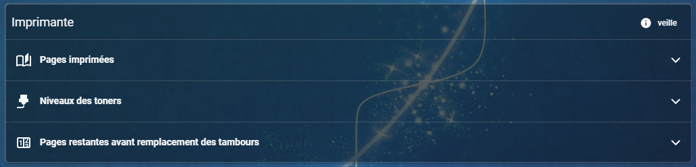
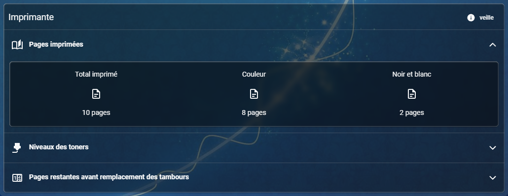
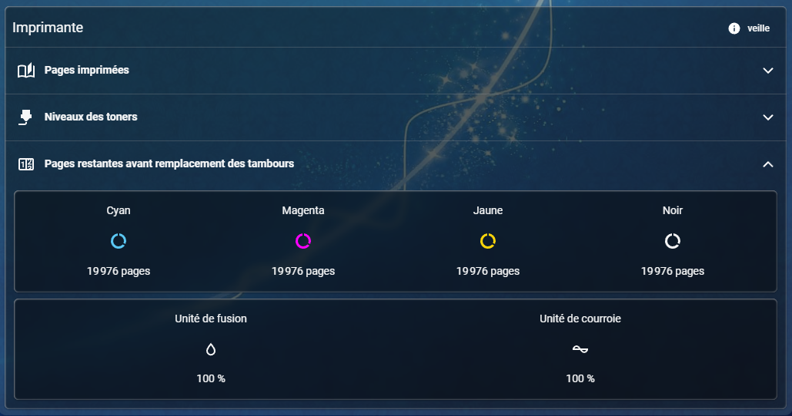

# Flex Accordion Card in use

These screenshots show a real Home Assistant installation with the maintainer’s theme. Card content and colours follow your own configuration and Home Assistant theme.

## Native cards inside an accordion

## Closed sections

## Printed pages

## Maintenance information

## Video demonstration

[Watch the demonstration (MP4, about 1 MB, 11 seconds)](media/accordion-demo.mp4)

The demonstration shows sections opening and closing. The video was resized to 720 pixels wide, with the original aspect ratio retained; audio and source metadata were removed. The original recording is unchanged.
